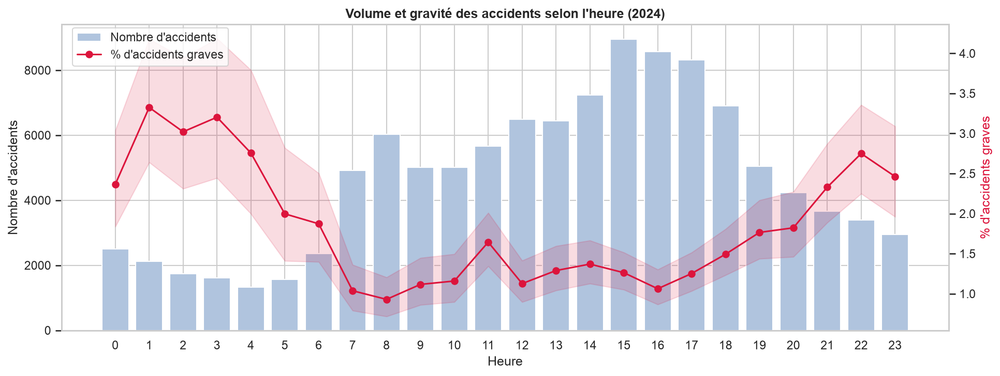
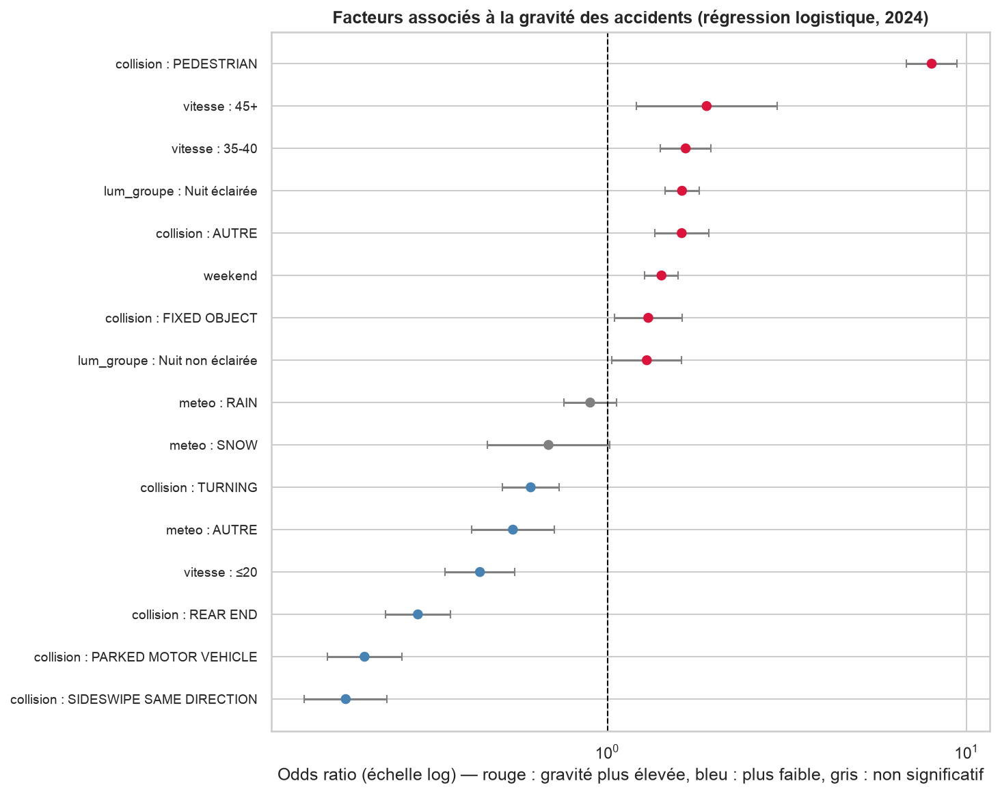
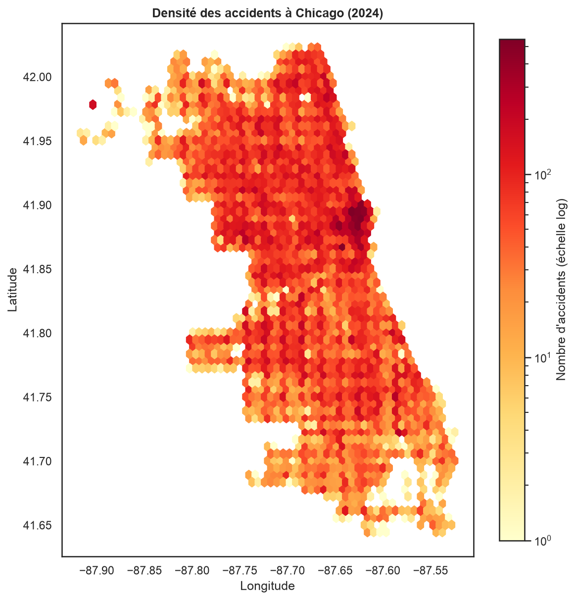
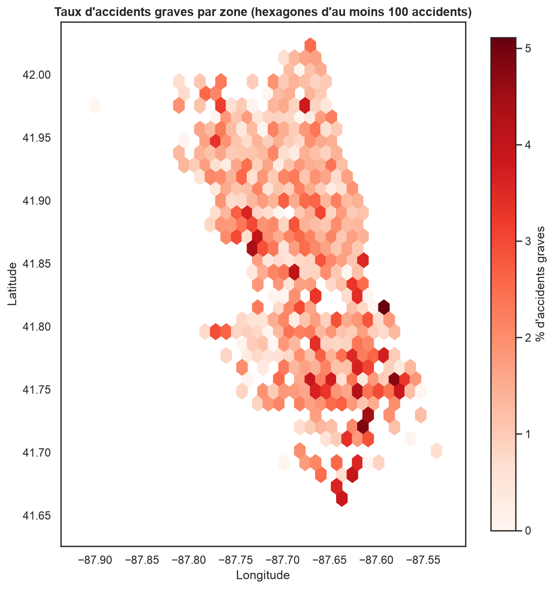

# RoadSafe Chicago : accidentologie routière à Chicago (2024)

Étude complète des **112 056 accidents de la route** enregistrés à Chicago en 2024, à partir des données ouvertes de la ville : collecte via API, contrôle qualité, analyse exploratoire, tests statistiques, analyse spatiale et dashboard interactif.

> **Problématique** : comment évoluent la fréquence et la gravité des accidents routiers à Chicago, et quels facteurs sont associés à leur gravité ?

L'analyse s'organise autour de quatre axes : **Quand ?** (saisonnalité, jours, heures), **Où ?** (répartition géographique), **Dans quel contexte ?** (météo, luminosité, vitesse, type de voie) et **Pour qui ?** (usagers impliqués, gravité des blessures).

---

## Principaux résultats

| Constat | Chiffre clé |
|---|---|
| Accidents enregistrés en 2024 | **112 056**, soit 306 par jour en moyenne |
| Accidents avec au moins un blessé | 16,5 % |
| Accidents graves (mortels ou blessé grave) | **1,56 %** (1 739 accidents) |
| Accidents mortels | 0,10 % (111 accidents, 123 décès) |
| Gravité d'une collision avec piéton | **14,8 %**, près de 10 fois la moyenne |
| Part des piétons et cyclistes | 4,8 % des accidents, mais **36 % des accidents graves** |

1. **Le volume suit le trafic, la gravité suit l'inverse.** Les accidents culminent en fin d'après midi, le vendredi et de mai à octobre. Mais les heures de pointe sont les moins graves (0,9 % à 8 h), alors que la nuit entre 1 h et 3 h dépasse 3 %.
2. **Le type de collision est le facteur dominant.** À autres facteurs égaux, un accident impliquant un piéton a environ 8 fois plus de chances d'être grave qu'une collision à angle droit (odds ratio 8,0, IC 95 % : 6,8 à 9,4).
3. **La vitesse affichée crée un gradient de gravité.** 0,8 % d'accidents graves sur les voies limitées à 20 mph ou moins, 2,6 % sur les axes à 35-40 mph.
4. **La nuit aggrave la gravité, même à type de voie, vitesse et collision égaux** (odds ratio 1,6 pour la nuit sur voie éclairée). Le week-end également (odds ratio 1,4), surtout la nuit.
5. **La météo n'aggrave pas la gravité.** Pluie et neige augmentent peu ou pas la part d'accidents graves, ce qui suggère une adaptation de la conduite.
6. **Volume et gravité ne se concentrent pas aux mêmes endroits.** Le centre (Loop) concentre les accidents, mais les taux de gravité les plus élevés se trouvent dans le South Side et le West Side. Aucun secteur de police n'est à la fois dans le top 10 en volume et dans le top 10 en gravité.

<p align="center">
  
</p>

<p align="center">
  
</p>

<p align="center">
  
  
</p>

---

## Démarche

Le projet suit quatre étapes : **collecter, fiabiliser, analyser, restituer**. Chaque notebook correspond à une étape et se termine par un bilan.

| # | Notebook | Contenu |
|---|---|---|
| 01 | [Collecte des données](Notebooks/01_Acc_Data_Collection.ipynb) | Extraction paginée depuis l'API Socrata, contrôle du volume et de l'unicité de la clé |
| 02 | [Compréhension des données](Notebooks/02_Acc_Data_Understanding.ipynb) | Inventaire des 49 colonnes, classement par rôle, premiers constats de qualité |
| 03 | [Nettoyage et qualité](Notebooks/03_Acc_Data_Quality_Cleaning.ipynb) | Typage, harmonisation des inconnues, flags de qualité, variables dérivées, rapport qualité |
| 04 | [EDA univariée](Notebooks/04_Acc_EDA_Univariate.ipynb) | Répartition par mois, jour, heure, conditions, type de collision et gravité |
| 05 | [EDA bivariée](Notebooks/05_Acc_EDA_Bivariate.ipynb) | Taux d'accidents graves par contexte, avec intervalles de confiance de Wilson |
| 06 | [EDA multivariée](Notebooks/06_Acc_EDA_Multivariate.ipynb) | Stratification pour contrôler les facteurs de confusion (nuit, éclairage, vitesse, collision) |
| 07 | [Tests statistiques](Notebooks/07_Acc_Tests.ipynb) | Chi², V de Cramér, ratios de risque avec correction de Bonferroni, régression logistique |
| 08 | [Analyse spatiale](Notebooks/08_Acc_Spatial_Analysis.ipynb) | Cartes de densité et de gravité, secteurs de police, carte interactive, export pour le dashboard |

### Choix méthodologiques

- **Signaler plutôt que supprimer** : aucune ligne n'est retirée au nettoyage. Les anomalies sont tracées par des flags (`geo_valid`, `speed_valid`, `injury_info_available`, `delay_valid`) et chaque analyse filtre selon ses besoins.
- **Raisonner en taux, pas en volumes** : un contexte fréquent n'est pas pour autant dangereux. La gravité est mesurée par la part d'accidents graves dans chaque groupe.
- **Variable de gravité `is_severe`** (mortel ou blessé grave) : les accidents mortels seuls sont trop rares sur une année pour des comparaisons fiables.
- **Tailles d'effet et intervalles de confiance** systématiquement rapportés : avec plus de 100 000 observations, une p-value seule ne dit rien de l'ampleur d'un écart.

---

## Dashboard

Le fichier [`Acc_Dashboard_Streamlit.py`](Acc_Dashboard_Streamlit.py) restitue l'étude sous forme interactive, en quatre onglets : vue d'ensemble, analyse spatiale, contexte et gravité, enseignements. Des filtres permettent de sélectionner les mois, la luminosité, la période (semaine ou week-end) et les types de collision.

```bash
streamlit run Acc_Dashboard_Streamlit.py
```

Le dashboard lit `data/analytics/fact_crashes_2024.parquet`, produit par le notebook 08.

---

## Structure du projet

```
.
├── Notebooks/                   # Notebooks 01 à 08
├── reports/
│   ├── figures/                 # Graphiques exportés et carte interactive (HTML)
│   └── rapport_qualite_2024.csv # Synthèse des contrôles qualité
├── data/                        # Non versionné, régénéré par les notebooks
│   ├── raw/                     # Données brutes de l'API (notebook 01)
│   ├── processed/               # Données nettoyées et enrichies (notebook 03)
│   └── analytics/               # Table de faits du dashboard (notebook 08)
├── Acc_Dashboard_Streamlit.py
├── requirements.txt
└── README.md
```

---

## Installation et reproduction

Prérequis : Python 3.13.

```bash
git clone https://github.com/filou337/Accident-de-la-route-Chicago.git
cd Accident-de-la-route-Chicago
python -m venv .venv
source .venv/bin/activate        # Windows : .venv\Scripts\activate
pip install -r requirements.txt
```

Les données ne sont pas versionnées (environ 60 Mo). Pour les régénérer, exécuter les notebooks **dans l'ordre**, depuis le dossier `Notebooks/` :

1. `01_Acc_Data_Collection.ipynb` télécharge les accidents 2024 dans `data/raw/`.
2. `03_Acc_Data_Quality_Cleaning.ipynb` produit `data/processed/crashes_2024.parquet`.
3. Les notebooks 04 à 08 lisent ce fichier ; le 08 exporte la table du dashboard.

Un jeton d'application Socrata est facultatif mais recommandé pour éviter les limitations de débit :

```bash
export SOCRATA_APP_TOKEN="votre_jeton"
```

> Les données de la ville sont mises à jour en continu (signalements tardifs, corrections). Une nouvelle extraction peut donc donner des chiffres très légèrement différents de ceux présentés ici.

---

## Données

- **Source** : [City of Chicago Open Data, Traffic Crashes, Crashes](https://data.cityofchicago.org/Transportation/Traffic-Crashes-Crashes/85ca-t3if) (identifiant `85ca-t3if`), via l'API Socrata.
- **Périmètre** : accidents survenus du 1er janvier au 31 décembre 2024.
- **Granularité** : une ligne par accident, identifiée par `crash_record_id`.

| Contrôle qualité | Lignes concernées | Traitement |
|---|---|---|
| Doublons sur la clé | 0 | Aucun |
| Coordonnées invalides ou absentes | 1 196 (1,07 %) | Mises à NA, flag `geo_valid` |
| Limite de vitesse irréaliste | 262 (0,23 %) | Conservée, flag `speed_valid` |
| Blessures non renseignées | 249 (0,22 %) | Gravité à NA, flag `injury_info_available` |
| Signalement antérieur à l'accident | 0 | Flag `delay_valid` |
| Météo inconnue | 8 826 (7,88 %) | Regroupée en UNKNOWN |
| Luminosité inconnue | 7 093 (6,33 %) | Regroupée en UNKNOWN |

---

## Limites

- **Pas de données d'exposition** : sans volume de trafic, les résultats décrivent la gravité des accidents survenus, pas le risque d'avoir un accident. Une zone avec beaucoup d'accidents est souvent simplement plus fréquentée.
- **Facteurs individuels absents** : vitesse réelle, alcool, port de la ceinture, âge des victimes.
- **Données déclaratives** : conditions et causes sont saisies par la police sur le terrain ; 46 % des causes principales sont inconnues.
- **Une seule année** : suffisante pour la saisonnalité, pas pour une tendance. Les accidents mortels sont trop rares pour être modélisés seuls.
- **Association, pas causalité** : les modèles mesurent des liens statistiques.

### Pistes d'évolution

- Étendre l'étude à 2018-2025 pour analyser les tendances et modéliser les accidents mortels.
- Croiser avec les tables *People* et *Vehicles* du même portail (âge, type d'usager, véhicule).
- Intégrer des données de trafic pour passer de la concentration d'accidents au risque.

---

## Stack technique

Python, pandas, NumPy, Matplotlib, Seaborn, SciPy, statsmodels, Folium, Plotly, Streamlit, Jupyter.

## Auteur

Philippe Roumbo, [@filou337](https://github.com/filou337)
